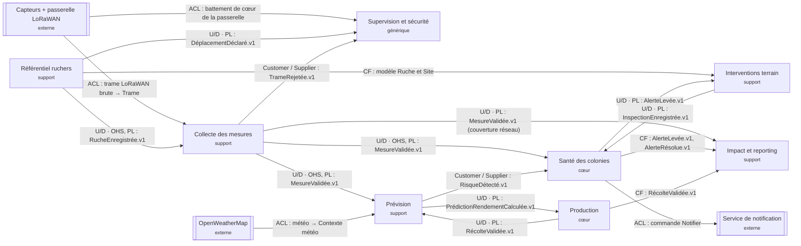

# Context map QueenBee · groupe data-1

## Relations

| Amont | Aval | Relation | Échange | Justification |
|---|---|---|---|---|
| Capteurs + passerelle LoRaWAN | Collecte des mesures | ACL | trame LoRaWAN brute → Trame | Le format radio du capteur ne doit pas entrer dans notre modèle |
| Capteurs + passerelle LoRaWAN | Supervision et sécurité | ACL | battement de cœur de la passerelle | La passerelle est un système externe : on traduit son signal en état de Passerelle |
| Référentiel ruchers | Collecte des mesures | U/D · OHS, PL | RucheEnregistrée.v1 | Collecte vérifie que hive_id est connu ; plusieurs consommateurs de l'inventaire |
| Référentiel ruchers | Interventions terrain | CF | modèle Ruche et Site | Interventions terrain reprend l'inventaire tel quel, sans le retraduire |
| Référentiel ruchers | Supervision et sécurité | U/D · PL | DéplacementDéclaré.v1 | Supervision compare la position GPS aux déplacements déclarés (UC-CY04) |
| Collecte des mesures | Santé des colonies | U/D · OHS, PL | MesureValidée.v1 | Santé des colonies calcule le score à partir des mesures |
| Collecte des mesures | Prévision | U/D · OHS, PL | MesureValidée.v1 | Le modèle de prédiction s'alimente des mesures validées |
| Collecte des mesures | Supervision et sécurité | Customer / Supplier | TrameRejetée.v1 | Supervision exprime son besoin (détecter les rejets répétés), Collecte le planifie |
| Collecte des mesures | Impact et reporting | U/D · PL | MesureValidée.v1 (couverture réseau) | Impact mesure la couverture réseau à partir des mesures reçues |
| OpenWeatherMap | Prévision | ACL | météo → Contexte météo | Le format d'OpenWeatherMap est traduit dans le vocabulaire de Prévision |
| Prévision | Santé des colonies | Customer / Supplier | RisqueDétecté.v1 | Santé exprime ce qu'il lui faut (type, confiance, recommandation) |
| Prévision | Production | U/D · PL | PrédictionRendementCalculée.v1 | Production compare chaque récolte à la prédiction |
| Production | Prévision | U/D · PL | RécolteValidée.v1 | Les récoltes validées servent à recalibrer le modèle |
| Santé des colonies | Interventions terrain | U/D · PL | AlerteLevée.v1 | Une alerte peut déclencher une visite anticipée |
| Interventions terrain | Santé des colonies | U/D · PL | InspectionEnregistrée.v1 | Une inspection permet de résoudre l'alerte |
| Santé des colonies | Impact et reporting | CF | AlerteLevée.v1, AlerteRésolue.v1 | Impact reprend les événements tels quels pour ses indicateurs |
| Production | Impact et reporting | CF | RécolteValidée.v1 | Impact reprend les récoltes validées pour le rendement |
| Santé des colonies | Service de notification | ACL | commande Notifier | On traduit nos alertes dans le format du service de notification |

Légende : U/D = amont/aval ; OHS = Open Host Service ; PL = Published Language ; C/S = Customer / Supplier ; CF = Conformist ; ACL = Anticorruption Layer.
