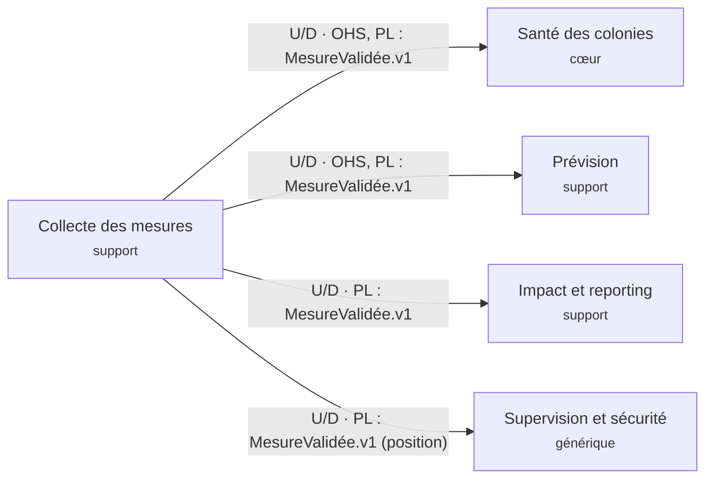

# Contrat de données · MesureValidée v1

- Version : 1 · Statut : proposé
- Propriétaire (producteur) : **Collecte des mesures**
- Origine : UC-T02 (mesures), UC-CY02 (rejets), UC-CY01 (mode dégradé)

## 1. Consommateurs

| Consommateur | Usage | Champs utilisés | Tolérance au retard |
|---|---|---|---|
| Santé des colonies | Score de santé, alertes sur une colonie | tous les capteurs, timestamp | faible : une mesure tardive ne lève pas d'alerte en temps réel |
| Prévision | Entrée du modèle de risque et de rendement | tous les capteurs, timestamp | forte : l'historique reste utile |
| Impact et reporting | Couverture réseau, indicateurs | hive_id, site_id, timestamp, battery_pct | forte |
| Supervision et sécurité | Détection de déplacement (UC-CY04) | hive_id, position_lat, position_lon | moyenne |

## 2. Champs de `payload`

| Champ | Type | Unité | Plage valide | Oblig. | Règle / remarque |
|---|---|---|---|---|---|
| hive_id | string | – | format `PP-SITE-NNN`, regex `^[A-Z]{2}-[A-Z]{2,6}-\d{3}$` (ex. SN-CASA-014) | oui | ruche connue du référentiel, sinon rejet |
| site_id | string | – | format `PP-SITE` (ex. SN-CASA) | oui | doit être le site de la ruche |
| timestamp | string ISO 8601 UTC | – | ≤ maintenant + 5 min | oui | avec hive_id : clé de déduplication |
| weight_kg | number | kg | 0 à 120 (à confirmer) | oui | variation brutale : signal de risque ou d'erreur ? (point chaud 7) |
| temp_internal_c | number | °C | 0 à 50 (à confirmer) | oui | température du couvain autour de 35 °C |
| temp_external_c | number | °C | -10 à 60 (à confirmer) | oui | |
| humidity_pct | number | % | 0 à 100 | oui | |
| acoustic_activity_score | number | score | 0 à 1 | oui | |
| battery_pct | number | % | 0 à 100 | non | sert à la couverture et à la maintenance |
| position_lat | number | degrés | -90 à 90 | non | lien avec UC-CY04 (déplacement) |
| position_lon | number | degrés | -180 à 180 | non | lien avec UC-CY04 (déplacement) |
| flags | array de string | – | `TARDIVE`, `VARIATION_BRUTALE` | non | ajouté par Collecte, jamais par le capteur |

Les plages marquées « à confirmer » sont à rapprocher du format 6.5 du cahier des charges.

## 3. Enveloppe

| Champ | Type | Description |
|---|---|---|
| eventId | uuid | identifiant unique de l'événement |
| type | string | `MesureValidée` |
| version | integer | 1 |
| occurredAt | string ISO 8601 UTC | date de la mesure |
| receivedAt | string ISO 8601 UTC | date de réception au central |
| producer | string | `Collecte des mesures` |
| payload | object | champs de la section 2 |

## 4. Exemple JSON valide

```json
{
  "eventId": "6f1c2a9e-5b7d-4c1e-9a3f-2d8e0b4c7a11",
  "type": "MesureValidée",
  "version": 1,
  "occurredAt": "2027-03-14T08:15:00Z",
  "receivedAt": "2027-03-14T08:41:12Z",
  "producer": "Collecte des mesures",
  "payload": {
    "hive_id": "SN-CASA-014",
    "site_id": "SN-CASA",
    "timestamp": "2027-03-14T08:15:00Z",
    "weight_kg": 34.2,
    "temp_internal_c": 34.8,
    "temp_external_c": 27.1,
    "humidity_pct": 58,
    "acoustic_activity_score": 0.72,
    "battery_pct": 91,
    "position_lat": 12.5833,
    "position_lon": -16.2833,
    "flags": []
  }
}
```

## 5. Exemple de rejet (`TrameRejetée.v1`)

```json
{
  "eventId": "0b9d3c52-77aa-4a0e-8d8e-5c1f2a6e9b10",
  "type": "TrameRejetée",
  "version": 1,
  "occurredAt": "2027-03-14T08:30:00Z",
  "receivedAt": "2027-03-14T08:41:15Z",
  "producer": "Collecte des mesures",
  "payload": { "hive_id": "SN-CASA-014", "reason": "HORS_PLAGE", "field": "weight_kg", "value": 480.0 }
}
```

Motifs : `HORS_PLAGE`, `REJEU`, `RUCHE_INCONNUE`, `FORMAT_INVALIDE`, `HORODATAGE_FUTUR`.

## 6. Règles

- **Déduplication** : clé = `hive_id` + `timestamp`. Une trame déjà reçue est rejetée (`REJEU`) et journalisée (UC-CY02).
- **Hors plage physique** : trame rejetée (`HORS_PLAGE`) et journalisée ; si les rejets se répètent pour une même ruche ou passerelle, une alerte d'intégrité est levée dans Supervision et sécurité.
- **Variation brutale** : une chute de poids importante n'est pas rejetée ; elle est publiée avec le drapeau `VARIATION_BRUTALE` pour que Santé des colonies décide.
- **Fréquence** : 1 mesure / 15 min en régime normal, 1 mesure / 5 min en surveillance renforcée. Volumétrie : 400 ruches × 4 mesures/h × 24 h = 38 400 mesures/jour, soit environ 0,44 mesure/s en moyenne. Rattrapage après panne d'une passerelle : un site de 50 ruches peut renvoyer jusqu'à 4 800 mesures d'un coup pour 24 h de coupure.
- **Retard maximal accepté** : proposition de 24 h (point chaud 3). Au-delà, la mesure est publiée avec `TARDIVE` : utile pour l'historique et la prédiction, pas pour une alerte en temps réel.
- **Versionnement** : ajout d'un champ optionnel = même version ; suppression, renommage ou changement d'unité ou de type d'un champ = `MesureValidée.v2`, publiée en parallèle de la v1 pendant une période de transition.
- **Mode dégradé** (UC-CY01) : les mesures sont conservées dans le cache de la passerelle puis renvoyées dans l'ordre de `occurredAt` à la resynchronisation.

## 7. Pourquoi deux dates, et l'impact sur les alertes

`occurredAt` est la date de la mesure ; `receivedAt` la date de réception au central, parfois des heures plus tard en mode dégradé. Les consommateurs doivent :

- ordonner les mesures par `occurredAt`, jamais par `receivedAt` ;
- calculer les seuils et les tendances sur `occurredAt` ;
- ne pas lever d'alerte en temps réel sur une mesure `TARDIVE`, mais l'intégrer au score et à l'historique ;
- faire partir le délai d'escalade de 48 h à la date de levée de l'alerte, pas à la date de la mesure.

## 8. Place sur la context map



## 9. Suite

Amorce de l'ADR : `adr/0001-ingestion-mesures-lots-ou-flux.md`.
